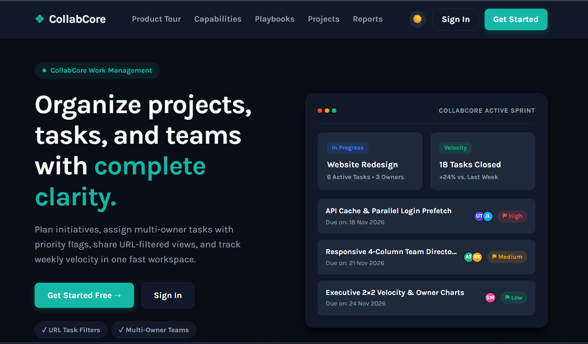

# CollabCore - Project & Task Management System

---

A MERN Stack **CollabCore** project management system to manage projects, create and assign tasks, track progress, and organize teams efficiently with secure authentication.  
Built with a React frontend, Express/Node backend, MongoDB database, and JWT-based authentication.

---

## Demo Link

[Live Demo](https://collab-core-br21.vercel.app/)

---

## Quick Start

```bash
git clone https://github.com/Sourabhpande532/CollabCore.git
cd CollabCore/client
npm install
npm start
```

---

## Technologies

- React.js
- React Router
- Node.js
- Express.js
- MongoDB & Mongoose
- JSON Web Token (JWT)
- bcryptjs (Password Hashing)
- Chart.js & react-chartjs-2
- Bootstrap 5 & Custom CSS3 Design Tokens
- RESTful APIs

---

## Demo Video

Watch a walkthrough (5-7 minutes) of all major features of this app:

[Drive Video Link](https://drive.google.com/file/d/15QX55FIjWCMrOuBl7EyAmGk_tTM_3pjA/view?usp=sharing)

---

## Reference Images



---

## Features

### Authentication & Authorization

**User Signup**

- Register with name, email, and password
- Password securely hashed using bcrypt

**User Signin**

- Login using email and password (or one-click Guest Login)
- Password verification using bcrypt
- JWT token issued upon successful login
- Token stored on frontend for authenticated requests
- User profile loaded via `GET /auth/me` to personalize the workspace navbar

**Protected Routes**

- JWT middleware protects mutation endpoints across projects, tasks, teams, tags, and comments
- Unauthenticated users attempting protected routes or actions are redirected to `/login`

**Logout**

- Token removed from frontend storage
- User redirected to login page

---

## Dashboard

- Global search across projects and tasks
- Overview of workspace projects with sorting (`A-Z`, `Z-A`, `Newest`)
- Personal & workspace task board with multi-parameter filtering (`Owner`, `Team`, `Project`, `Tag`, `Status`, `Sort`)
- Quick actions to create projects, create tasks, mark tasks completed, or delete items

---

## Project Management

- Create, view, search, sort, and delete projects
- Project Details view grouping tasks by project with filters by `Status`, `Owner`, `Tag`, and `Sort`
- Built-in Project Discussion comments section

---

## Task Management & URL-Based Filtering

- Create, view, update, and delete tasks
- Assign tasks to a Project, Team, and multiple Owners
- Configure Status (`To Do`, `In Progress`, `Completed`, `Blocked`), Priority (`High`, `Medium`, `Low`), Time to Complete (days), Due Date, and custom Tags
- Shareable URL-based filtering & sorting (e.g., `/tasks?owner=Tanay`, `/tasks?team=development&tags=Urgent`)

---

## Team Management

- Create and manage teams with member rosters
- Add members to existing teams
- Team Details view with task filtering by `Status` and `Member`, and sorting by `Time to Complete` or `Status`

---

## Reports & Analytics

- **Total Work Done Last Week:** Bar chart of tasks completed in the last 7 days
- **Total Days of Work Pending:** Bar chart of estimated remaining days across open tasks
- **Tasks Closed Breakdown:** Pie chart of completed tasks grouped by **Team**, **Owner**, or **Project**

---

## API Reference

### Authentication APIs

- `POST /auth/signup` — Register a new user
- `POST /auth/login` — Authenticate user and receive JWT
- `GET /auth/me` — Fetch authenticated user details (Protected)
- `GET /auth/users` — Fetch workspace users

### Task APIs

- `GET /auth/tasks` — Retrieve tasks with URL query filtering (`owner`, `owners`, `team`, `project`, `tags`, `status`, `sort`)
- `GET /auth/tasks/filter` — Retrieve filtered tasks
- `GET /auth/tasks/team/:id` — Retrieve tasks assigned to a specific team
- `GET /auth/tasks/:id` — Fetch single task details
- `POST /auth/tasks` — Create new task (Protected)
- `POST /auth/tasks/:id` — Update existing task (Protected)
- `PUT /auth/tasks/:id/status` — Update task status (Protected)
- `DELETE /auth/tasks/:id` — Delete task (Protected)

### Project, Team, Tag & Report APIs

- `GET /auth/projects`, `POST /auth/projects` (Protected), `DELETE /auth/projects/:id`
- `GET /auth/teams`, `POST /auth/teams` (Protected), `GET /auth/teams/:id`, `POST /auth/teams/:id/members` (Protected)
- `GET /auth/tags`, `POST /auth/tags` (Protected)
- `GET /auth/report/last-week`, `GET /auth/report/pending`, `GET /auth/report/closed-tasks`
- `GET /auth/comments/project/:projectId`, `POST /auth/comments` (Protected)

---

### Environment Setup

**Backend (`/server/.env`)**

```env
PORT=4001
MONGO_URL=mongodb+srv://<username>:<password>@cluster.mongodb.net/myWorkasanaDatabase
JWT_SECRET=your_jwt_secret_key
```

**Frontend (`/client/.env`)**

```env
REACT_APP_API_URL=http://localhost:4001/auth
```

---

## Contact

For bugs or feature requests, please reach out to [sourabhpande43@gmail.com](mailto:sourabhpande43@gmail.com)
